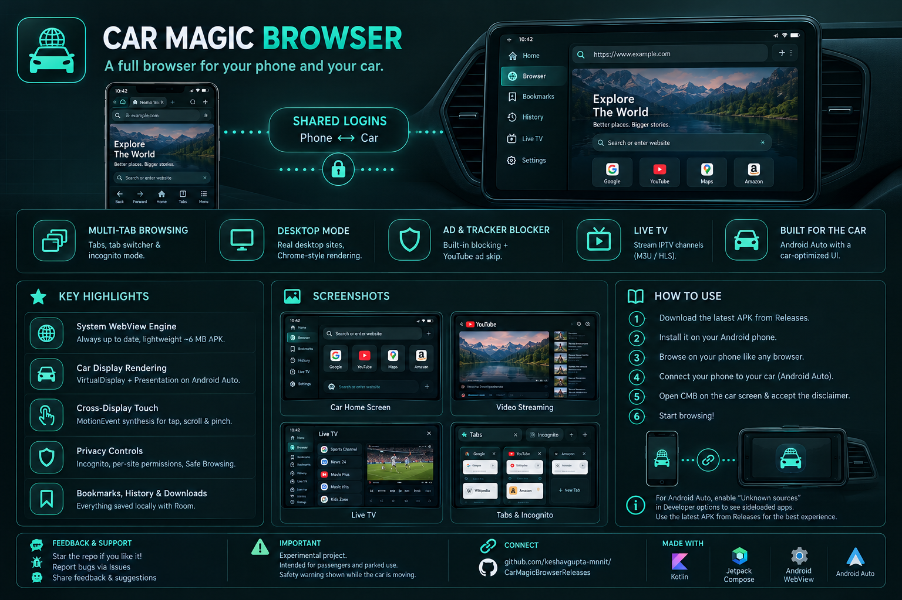

# 🚗 Car Magic Browser (CMB)

  

  
  &nbsp;
  

  
  
   
  <a href="https://github.com/keshavgupta-mnnit/CarMagicBrowserReleases/releases">All releases & changelogs</a>

---

## ✨ Overview

**Car Magic Browser (CMB)** is a full-featured web browser for Android phones **and Android Auto car displays**.

Browse any website, watch videos, stream Live TV and manage multiple tabs on your phone, then continue on your car's screen with the same logins and your last page. It is built to feel like Chrome or Opera, with a dedicated car interface designed for large in-car displays.

---

## 🚀 Key Features

### 🌐 Browsing
- **Multiple tabs** with a visual tab switcher (grid & stack views)
- **Incognito mode**: no history, no cookies kept, downloads blocked
- **Desktop mode** with Chrome-style rendering (sites show their real desktop layout)
- **Smart address bar**: type a website or search, with suggestions from history & bookmarks
- **Choice of search engine**: Google, DuckDuckGo or Bing
- **Find in page**, pinch-to-zoom and a car zoom stepper
- **Bookmarks, history & downloads manager**
- **Long-press menu**: open in new tab, share, save image
- **Fullscreen video** playback

### 🛡️ Privacy & Ad Blocking
- **Built-in ad blocker & tracker blocker** with a per-site allowlist
- **YouTube ad skipper**
- **Safe Browsing** protection
- **Per-site permissions** for camera, microphone & location
- **Clear browsing data**: history, cookies, cache, tabs, saved passwords

### 📺 Live TV (IPTV)
- Built-in **Live TV player** for M3U / HLS playlists
- Channel list with filters, inline player on phone, fullscreen player in the car

### 🚘 Made for the Car
- Runs on **Android Auto** displays
- **Car-optimised interface** with a side navigation rail and large touch targets
- **Shared logins & cookies** between phone and car, so you stay signed in everywhere
- Resumes your **last visited page** on the car screen
- **Safety banner** appears automatically when the car is moving

---

## 🧠 Under the Hood

- **Android System WebView** engine (always up to date via Play Store)
- **Jetpack Compose + Material 3** UI, separate phone and car layouts
- **Android for Cars App Library** + **VirtualDisplay / Presentation** for car rendering
- **MotionEvent synthesis** for touch, scroll & pinch on the car screen
- **Room** database for tabs, history, bookmarks & downloads
- **Hilt** dependency injection, MVI-style browser state
- **Media3 ExoPlayer (HLS)** for Live TV
- **MediaDrm + Firebase Firestore** for hardware-backed user acknowledgment
- **Firebase Remote Config & Crashlytics** for stability
- **GitHub Actions** CI/CD for signed builds & releases

---

## 📦 Lightweight APK

CMB uses the **WebView already on your phone**, so it no longer bundles a full browser engine:

- **Small download** (~6 MB)
- Browser engine stays **updated automatically** through the Play Store
- Built-in **update checker** tells you when a new release is out

---

## 📱 How to Use

1. Download the latest APK using the **Download** button above
2. Install it on your Android phone
3. Use it as a regular browser on your phone
4. Connect your phone to your car (Android Auto)
5. Open **Car Magic Browser** on the car screen and accept the disclaimer
6. Start browsing!

> ℹ️ **Don't see the app in Android Auto?** Open Android Auto settings, enable **Developer mode** (tap *Version* 10 times), then turn on **Unknown sources** in Developer settings so sideloaded apps appear.

---

## ⚠️ Safety Notice

CMB is an **independent, experimental project**.

- Intended for **passengers and parked use**
- Shows a **safety warning when the vehicle is moving**
- Requires **user acknowledgment** before first use in the car
- Always follow local traffic laws and use responsibly

---

## 🔍 Tech Stack

- Kotlin · Jetpack Compose · Material 3
- Android System WebView + AndroidX WebKit
- Android for Cars App Library
- VirtualDisplay · Presentation API · MotionEvent injection
- Room · Hilt · Coroutines
- Media3 ExoPlayer (HLS)
- MediaDrm · Firebase Firestore · Remote Config · Crashlytics
- GitHub Actions (CI/CD)

---

## 💬 Feedback & Support

- ⭐ Star the repo if you like it
- 🐞 Report bugs via [Issues](https://github.com/keshavgupta-mnnit/CarMagicBrowserReleases/issues)
- 💡 Share feedback & feature suggestions

---

## 📥 Download

- ✅ **Latest release:** [Download APK](https://github.com/keshavgupta-mnnit/CarMagicBrowserReleases/releases/latest/download/app-release.apk)
- 🚀 **Early Access (newest build):** [Download APK](https://github.com/keshavgupta-mnnit/CarMagicBrowserReleases/releases/download/early-access/app-release.apk)
- 📜 **All versions & changelogs:** [Releases page](https://github.com/keshavgupta-mnnit/CarMagicBrowserReleases/releases)

---

## 👨‍💻 Author

**Keshav Gupta**
Android Developer

---

⭐ If you found this interesting, consider starring the repo!